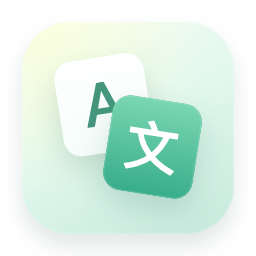

<p align="center">
  
</p>

<h1 align="center">LanguageSwitcher</h1>

<p align="center">让应用，说你的语言。</p>
<p align="center">无需更改系统语言，为单个 macOS 应用选择本次启动的语言。</p>

<p align="center">
  
  
  <a href="https://github.com/tianguzhe/LanguageSwitcher/actions/workflows/release.yml"></a>
</p>

<p align="center">
  <a href="https://github.com/tianguzhe/LanguageSwitcher/releases">下载发布版</a> ·
  <a href="https://github.com/tianguzhe/LanguageSwitcher/actions/workflows/release.yml">获取构建包</a> ·
  <a href="docs/DEVELOPMENT.md">开发与发布</a>
</p>

## 功能

- **单独选择启动语言**：为选中的应用传入语言偏好，保留系统语言设置。
- **拖入即可识别**：拖入 `.app`，或按 `⌘O` 从本机选择应用，自动扫描其内置语言资源。
- **快速找到语言**：按名称、原生名称或语言代码搜索，例如「中文」「English」「en」。
- **常用语言优先**：繁体中文 → 英语 → 简体中文 → 其他语言，支持地区与文字变体。
- **原生 macOS 体验**：SwiftUI 界面、浅薄荷配色，单个 Universal 安装包兼容 Apple Silicon 与 Intel。

## 安装

需要 **macOS 14 或更新版本**。

1. 从 [Releases](https://github.com/tianguzhe/LanguageSwitcher/releases) 下载 `LanguageSwitcher.dmg`。
2. 打开 DMG，将 LanguageSwitcher 拖入 Applications。
3. 从「应用程序」打开 LanguageSwitcher。

尚未发布版本时，可在 [GitHub Actions](https://github.com/tianguzhe/LanguageSwitcher/actions/workflows/release.yml) 中打开最近一次成功的构建，在 Artifacts 区域下载 `LanguageSwitcher-<版本>`，解压后获取 DMG。下载 Actions artifact 需要登录 GitHub。

安装包采用 ad-hoc 签名，尚未进行 Apple 公证。首次打开如被 macOS 拦截，请在「系统设置 → 隐私与安全性」中允许打开。

## 使用

1. **退出目标应用**，避免已有进程忽略新的启动参数。
2. 将目标 `.app` 拖入 LanguageSwitcher，或点击「选择应用」。
3. 选择一种语言；语言较多时，可使用搜索框筛选。
4. 点击语言卡片启动目标应用。启动成功后，LanguageSwitcher 自动退出。

语言偏好仅用于本次启动。直接再次打开目标应用时，会按该应用自身的设置运行。

## 常见问题

**为什么没有显示语言？**

LanguageSwitcher 扫描应用 `Contents/Resources` 下的 `.lproj` 目录，并过滤 `Base`。部分应用使用自定义资源组织或语言设置，不会显示可识别的语言；它也不能为应用添加尚未内置的翻译。

**为什么启动后语言没有改变？**

先完全退出目标应用再试。部分应用会优先使用自身的语言设置，或忽略 `AppleLanguages` 启动参数。

**需要更改系统语言或修改目标应用吗？**

不需要。LanguageSwitcher 通过 macOS 的 `open` 命令传入启动参数，不会改写目标应用的资源文件。

## 从源码构建

需要完整 Xcode，以及 Python 3.10+。

```bash
git clone https://github.com/tianguzhe/LanguageSwitcher.git
cd LanguageSwitcher
bash scripts/test.sh
bash build_universal.sh
```

生成 `build/LanguageSwitcher.app`、`dist/LanguageSwitcher.dmg` 及 SHA-256 校验文件。完整参数、缓存说明、图标生成和 GitHub Release 流程见 [开发文档](docs/DEVELOPMENT.md)。

## 致谢

构建与发布流程参考 [QuietLock](https://github.com/tianguzhe/QuietLock)，使用 Xcode 构建 Universal 应用，通过 `dmgbuild` 创建带 Retina 背景的拖拽安装包。
